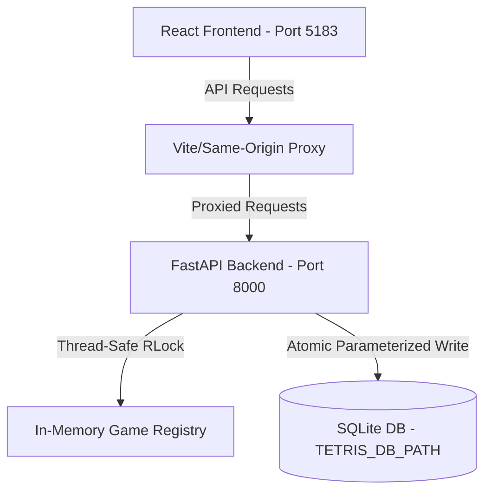

# Architecture Spine — Stage 3 Option A

## Design Paradigm
The application employs a decoupled client-server architecture. The frontend is a stateless, pure-presentational React/TypeScript application, while the backend is a single-process Python FastAPI service that holds authoritative game logic and controls persistent high-score transactions.



## Inherited Invariants
This spine is a brownfield extension of the Stage 2 Option A architecture. It inherits all core gameplay, movement, and scoring invariants as binding read-only rules.

| Inherited | From parent | Binds here |
| --- | --- | --- |
| AD-1 to AD-20 | Stage 2 Option A Spine | Baseline Tetris mechanics, progressive gravity, next/hold previews, and in-memory session lifecycles. |

## Invariants & Rules

### AD-21 — Threadpool Concurrency Protection via RLock

- **Binds:** FR-58, FR-59, FR-61, FR-62
- **Prevents:** Thread race conditions, dirty reads of active game sessions, and duplicate/corrupted SQLite database transactions inside the FastAPI threadpool.
- **Rule:** [ADOPTED] All game sessions registry operations (creation, lookup, mutation), SQLite transaction finalizations, and response snapshotting must run synchronized under a single, process-wide reentrant lock (`threading.RLock`). Read-only endpoints (`GET /api/games/:id` and `GET /api/high-scores`) must also acquire this lock to extract a consistent write-free snapshot, preventing side-effects from concurrent writes.

### AD-22 — Parametric SQLite High Scores Persistence

- **Binds:** FR-55, FR-56, FR-57
- **Prevents:** SQL injection vulnerabilities, duplicate record insertion for a single game, and data loss after container/service restart.
- **Rule:** [ADOPTED] High scores are persisted in SQLite using Python's standard `sqlite3` module under an absolute schema containing: `game_id` (TEXT PRIMARY KEY), `score` (INTEGER), `total_lines` (INTEGER), `level` (INTEGER), and `completed_at` (TEXT ISO-8601). Every insert must be a parameterized query. Games are eligible for persistence strictly upon the first authoritative `game_over` transition, and `completed_at` must be assigned exactly once and remain immutable across retries.

### AD-23 — Fail-Safe Finalization and Retry Flow

- **Binds:** FR-61, FR-62
- **Prevents:** Engine crashes, state corruption, or missing leaderboard records due to transient database failures (disk full, lock timeout, startup/cleanup errors).
- **Rule:** [ADOPTED] If a database transaction fails during a terminal game-over event, the backend must roll back the transaction, mark the state's internal `persisted` flag as `False`, and return a controlled `HTTP 503 Service Unavailable` response with hidden file paths and SQL details. Any subsequent mutating requests (such as manual moves or gravity ticks) on that terminal session must retry persistence under the `threading.RLock`, whereas `GET` requests never perform retries.

### AD-24 — Strict Body Validation

- **Binds:** FR-60
- **Prevents:** Under-validated requests, security vulnerabilities, or metadata injection from client-supplied scores, levels, or completion timestamps.
- **Rule:** [ADOPTED] All game creation (`POST /api/games`) and movement (`POST /api/games/:id/move`) request bodies must be strictly validated. Any extra or unexpected JSON payload fields must trigger immediate rejection with an `HTTP 422 Unprocessable Entity` response, rather than being silently ignored.

### AD-25 — Multi-Stage Non-Root Dockerization

- **Binds:** FR-66, FR-67
- **Prevents:** Insecure runtime execution, container privilege escalation, and swollen image footprints in local deployments.
- **Rule:** [ADOPTED] Services are built using multi-stage Dockerfiles. All runtime container processes must execute under restricted non-root users (`appuser` for backend, `node` for frontend) with `security_opt: no-new-privileges:true`. The database file must reside in a mounted named volume `tetris_sqlite_data` with write permissions restricted to the backend user. Only host port `5183` is exposed, mapping directly to the frontend, while the backend port `8000` remains strictly internal.

### AD-26 — Isolated Frame-Level Performance Verification

- **Binds:** FR-68
- **Prevents:** False-positive performance metrics, simple CPU timer reliance, and artificial benchmark inflation.
- **Rule:** [ADOPTED] Performance benchmarking is executed using Playwright Chromium in separate foreground trials under active keyboard gameplay. The analysis window is strictly fixed between `5000ms` and `35000ms` of the test run, counting only intervals where BOTH endpoints reside inside this window. Mean FPS must be calculated strictly as `frame_count / 30.0` (not based on median). Operational targets are a mean frame rate `>= 55 FPS` and a `p95` interval `<= 25 ms` in all runs. No artificial loops, gravity alterations, or physical rotation modifications are allowed.

### AD-27 — Pinned Continuous Integration Pipeline

- **Binds:** FR-69
- **Prevents:** Environment drift, missing dependencies, and compromised builds in CI.
- **Rule:** [ADOPTED] Continuous Integration runs on GitHub Actions pinned to Node.js 20 and Python 3.11. Dependencies are installed in actual working directories using lockfiles (`package-lock.json` and `requirements.txt`). The pipeline must enforce strict unit test coverage, compile a production bundle, run supported public security dependency audits, and verify Docker image builds. Bypasses such as `|| true` on security audit checks are prohibited.

---

## Consistency Conventions

| Concern | Convention |
| --- | --- |
| Database Initialization | Idempotent schema initialization on backend service startup. Re-creates tables only if missing. |
| Time Formats | All dates and completion times are recorded as UTC ISO-8601 strings (`YYYY-MM-DDTHH:MM:SSZ`). |
| Same-Origin Proxying | Vite's proxy configuration in development and Docker Compose in production must route `/api/*` to the backend on port `8000`. |
| Error Handling | All 503 database errors must return a standardized JSON structure with a message hiding system files and stack traces. |

---

## Stack

| Name | Version |
| --- | --- |
| Python | 3.11 |
| FastAPI | 0.162.0 |
| SQLite | 3 |
| Node.js | 20 |
| React | 18.3.1 |
| Vite | 6.4.5 |
| Vitest | 4.1.12 |
| Playwright | 1.49.0 |

---

## Structural Seed

```text
{root}/
  backend/
    app/
      main.py          # FastAPI application entrypoint and synchronization locks
      core/
        domain.py      # Core Tetris board state models and transition rules
      tests/
        test_api.py    # Backend endpoint integration tests and persistence failure simulations
    Dockerfile         # Multi-stage backend container definition (non-root)
  frontend/
    src/
      main.tsx         # App entrypoint
      App.tsx          # High Scores panel UI and state hooks
    Dockerfile         # Multi-stage frontend reverse-proxy container definition (non-root)
  compose.yaml         # Docker Compose orchestration
```

---

## Capability → Architecture Map

| Capability / Area | Lives in | Governed by |
| --- | --- | --- |
| SQLite Storage & Path | `backend/app/main.py` | AD-22, FR-55, FR-56 |
| Thread Safety Lock | `backend/app/main.py` | AD-21, FR-58, FR-59 |
| Persistence Failure Retry | `backend/app/main.py` | AD-23, FR-61, FR-62 |
| Strict Payload Validation | `backend/app/main.py` | AD-24, FR-60 |
| High Scores Panel | `frontend/src/App.tsx` | FR-63, FR-64 |
| Multi-Stage Containerization | `backend/Dockerfile`, `frontend/Dockerfile` | AD-25, FR-66, FR-67 |
| Playwright Benchmarking | `frontend/tests/perf.spec.ts` | AD-26, FR-68 |
| CI Pipeline | `.github/workflows/ci.yml` | AD-27, FR-69 |

---

## Deferred
- Resuming active games from SQLite database (remains in-memory).
- PostgreSQL or other containerized database server scaling.
- Piece rotation (wall-kicks, T-Spins, Standard Rotation System) remains out of scope.
- Cloud-native cluster deployments and auto-scaling.
